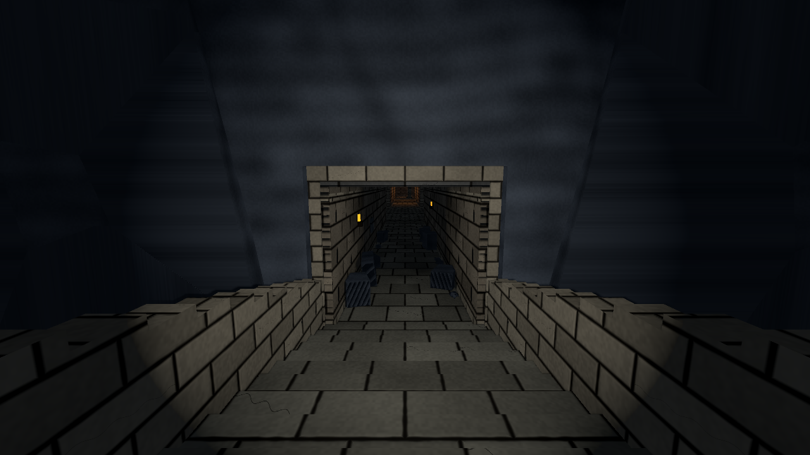
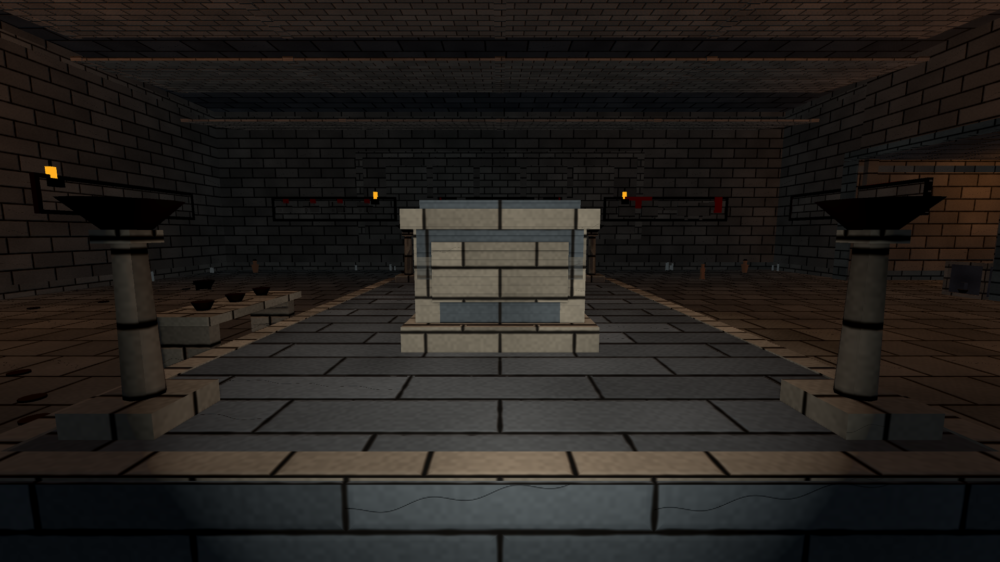
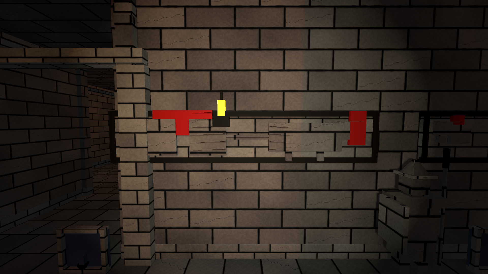
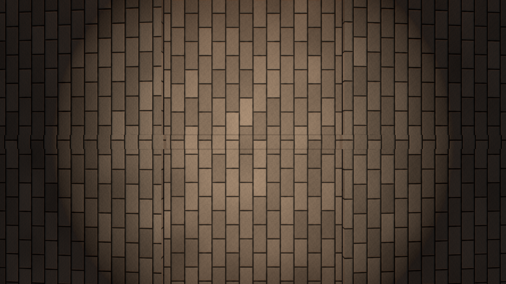

# Three Feet Under（三英尺之下）

> 东汉末年 · 单人第一人称古墓探索游戏（Godot 4.7.2）—— 墓道搭建与关卡原型仓库。

## 这是什么

玩家扮演一名被生计逼到绝境的探墓者，踏入一座东汉古墓。故事强调"活下去不容易"：墓道、机关、画像石上的故事与随葬器物一起，构成对闯入者的筛选；玩家从墓室、壁画、棺椁刻画和遗留痕迹中拼出真相，而不是只听角色讲解。

**当前状态：墓道灰盒 → 装饰与中式美术风格逐步落地的可玩原型。** 墓道 01—12 段已全部搭建，美术采用方块化风格，配世界坐标投影材质（1.5 倍环境放大后砖石尺寸不变）。

## 截图速览

| 入口墓道 | 主墓室石棺与灯台 |
|---|---|
|  |  |
| 画像石浮雕带（涂朱） | 券顶砖砌拱券（仰视） |
|  |  |

更多按批次归档的截图见 [项目进度刻画图片/](项目进度刻画图片/README.md)（蜡烛近景、深渊、各处细节等共 95 张）。

## 快速开始

1. 安装 [Godot 4.7.2](https://godotengine.org/download)（Windows 版，带 console 控制台）。
2. 用 Godot 打开 `three-feet-under/project.godot`（GL Compatibility 渲染、Jolt 物理）。
3. 按 F5 运行：出生在 01 楼梯顶，WASD 移动、鼠标观察、空格跳跃、**CapsLock 切换疾跑**、Shift 静步、Ctrl 蹲下、E 阅读石板。

## 目录结构

| 路径 | 说明 |
|---|---|
| `three-feet-under/` | **Godot 工程根**（project.godot / main.tscn / 关卡与脚本） |
| `three-feet-under/tomb_corridor.tscn` | 主关卡：墓道 01—12 段，含建筑、机关、蜡烛、装饰 |
| `three-feet-under/art/` | 美术资源管线：着色器、材质、道具生成器、渲染截图脚本 |
| `three-feet-under/tests/` | headless 测试与回归检查（`--script` 方式运行） |
| `docs/baselines/` | 1.5 倍环境放大审计基线等 |
| `项目进度刻画图片/` | 历次渲染截图归档（95 张，按批次分目录，配 README） |
| `故事背景.md` / `游戏主题与设定讨论稿.md` | 立项讨论稿：故事、主题、时代设定 |
| `项目进度.md` | 开发进度日志（按日期追加） |
| `新手教程墓道大致图demo.png` | 墓道图纸（俯视图） |

## 分工

| 角色 | 负责 |
|---|---|
| 穆柏润（本仓库主人） | **墓道搭建**：建筑、材质、装饰（石狮/封印台/石棺/守卫/陶罐/铜鼎/壁龛/祭案/兵器架/蜡烛/中式券顶与画像石浮雕带等） |
| 伙伴（Codex 侧） | **机关**：双印青铜门、火把拉杆墙、地刺、断桥、压力板、飞镖陷阱等 |

两侧通过同一 GitHub 仓库协作（`git pull` / `push` 同步），机关侧分支与墓道侧随后整合。

## 已完成里程碑

- 墓道 01—12 灰盒搭建 + 玩家第一人称控制（出生点、疾跑、深渊坠落重启）
- 环境 **1.5 倍放大**（建筑整体放大，玩家与材质米数不变，`docs/baselines/` 有审计）
- **279 支未点燃蜡烛**（静态 MultiMesh，离线生成器摆放）
- 装饰三版：石狮/封印台/石棺/守卫/灯台 → 陶罐/铜鼎/壁龛/祭案/兵器架 → **中式风格**（券顶砖缝、画像石浮雕带涂朱、博山炉、陶俑、五铢钱）
- **渲染截图归档** `项目进度刻画图片/`：每次视觉效果变化随代码一起提交

## 验证与测试

```powershell
# 在 three-feet-under/ 下，用 Godot 控制台版运行 headless 测试
& "…\Godot_v4.7.2-stable_win64_console.exe" --headless --path . --fixed-fps 60 --script res://tests/environment_scale_check.gd
```

- `environment_scale_check.gd`：尺度审计（1374 断言，failures=0）
- `player_controls_check.gd`：移动/疾跑/深渊重启（70 项，failures=0）
- `side_wings_check.gd` / `final_wing_check.gd`：侧翼与末端翼回归（其中个别失败来自机关侧路线改动，见 `tests/README.md`）
- 渲染截图：`art/tools/capture_decor_review.gd` 输出 `%TEMP%\tfu_decor_review\`（21 张 1080p），归档至 `项目进度刻画图片/07-装饰大全/`

## 下一步 / 待办

- **07 深渊断桥**：游戏内预期还缺桥/绳，等待机关侧方案（伙伴分工）。
- **机关整合后的回归**：`side_wings_check` / `final_wing_check` 目前仍红（被伙伴机关路线挡住），等机关侧改动合并后重新跑绿。
- **中式风格扩展候选**：砖缝/券顶之外的涂朱彩绘细化、壁画与画像石叙事串联、更多明器（陶仓/陶楼/井/灶）等。
- **试玩反馈**：跑通全流程后根据手感调整出生点/难度/灯光。

## 相关链接

- GitHub 仓库：https://github.com/Baron0224/Three-Feet-Under
- 讨论稿：[故事背景.md](故事背景.md) · [游戏主题与设定讨论稿.md](游戏主题与设定讨论稿.md)
- 进度：[项目进度.md](项目进度.md)
- 截图归档：[项目进度刻画图片/](项目进度刻画图片/README.md)
- 美术细节：[three-feet-under/art/README.md](three-feet-under/art/README.md)
- 测试说明：[three-feet-under/tests/README.md](three-feet-under/tests/README.md)